# MORI

**A love letter to [MEMENTO | Enjoy-Lab](https://www.enjoy-lab.com/memento).** MORI is my own circuitry, programmed by logic: not their code, not a clone, not a port. For the Akai Force and MPC OS (VST2, ARMv7). Vendor: L'Cronx. Current version: 0.6.4 (tested on Akai Force, see Status).

MORI is an effect for making sound drift, repeat and dissolve. Play anything through it, then record a loop of what you hear into the DUB layer,
send the result around a delay, a memory of moving heads or a cloud of grains, and let it all fall into a reverb. Two step modulators and a touch bar keep it moving. Thirteen pages, big
knobs, nothing hidden.

## What it does

* **DUB** – a loop that follows the project tempo (1 to 16 beats). Record into it, add layers, replace it, or let it forget.
* **DELAY** – a stereo delay with a different note value on each side, tape-style or jumping time changes, and a filter inside the feedback.
* **TEXTURE** – a short memory of the last seconds of sound, played back by several heads at different speeds and directions, or cut into grains. Freeze it with BLOCK.
* **REVERB** – five characters, with a high-pass before the reverb and an octave-up shimmer.
* **FILTER** – one knob sweeps low-pass to the left and high-pass to the right.
* **MASTER FX** – exciter, tape saturation or tube warmth, then a soft limiter.
* **ROUTING** – 14 switches decide who feeds whom, plus one switch for the order of DELAY and TEXTURE.
* **SEQ 1, SEQ 2** – two 16-step modulators that move any of 23 controls in time with the project: gates, filter steps, grain melodies, tape stops.
* **TOUCH** – a touch bar with three zones (FILTER, DELAY, SPACE), each moving three controls at once; the filter zone opens from left to right.
* **PRESETS** – 69 factory presets, a preset page on the Force, and room for 964 of your own.
* **BROWSER EDITOR** – MORI serves its own editor page: every control live in both directions, step drawing, preset naming, export and import.

## The panel

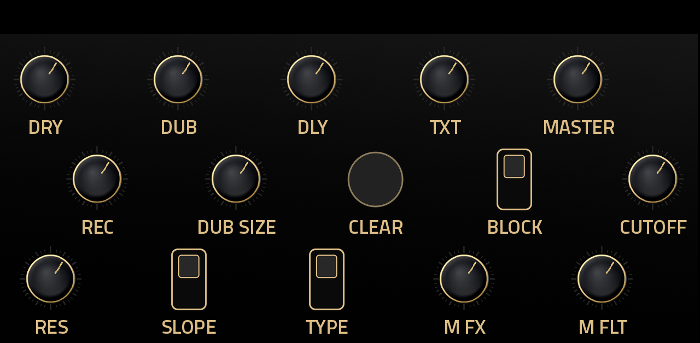
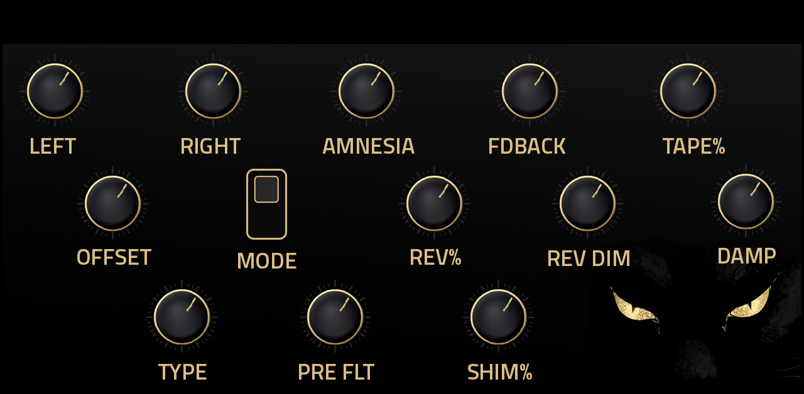
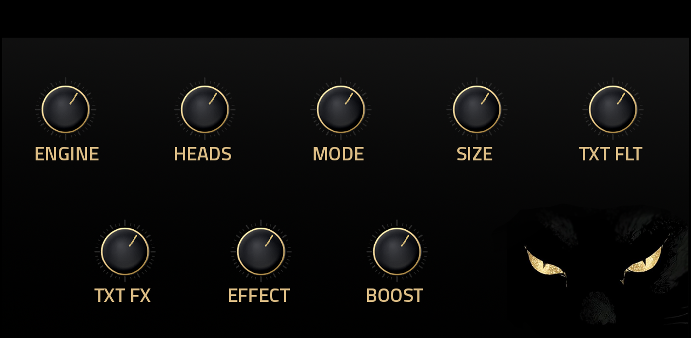
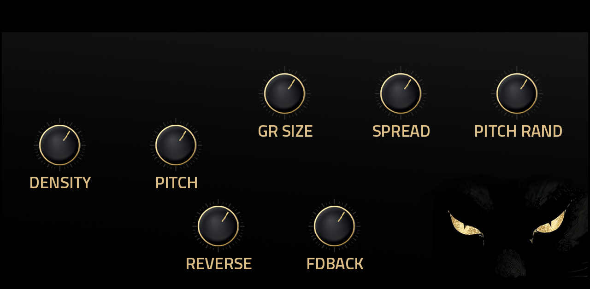
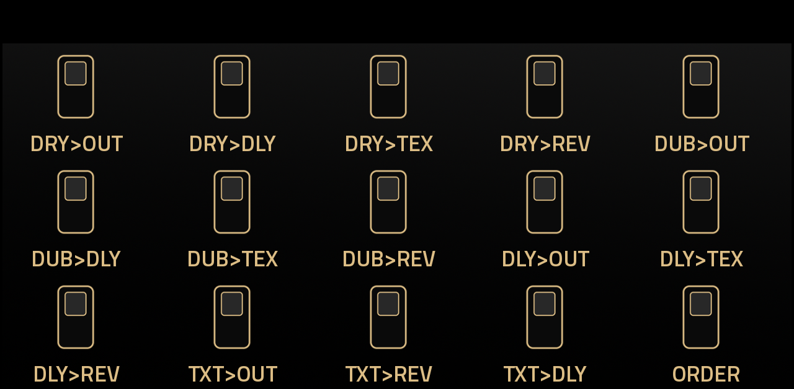
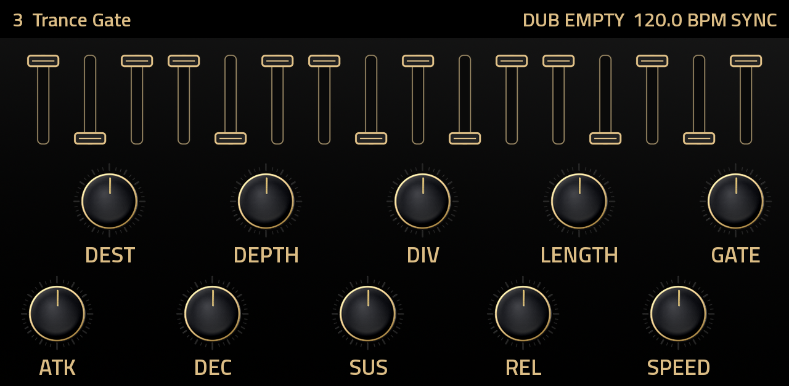
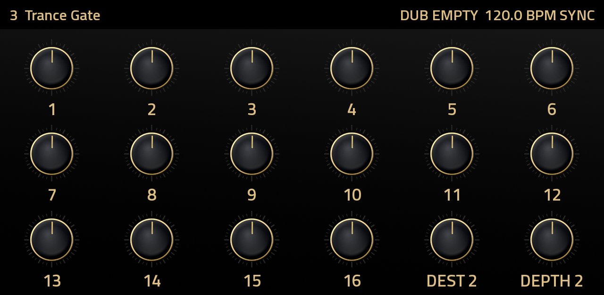
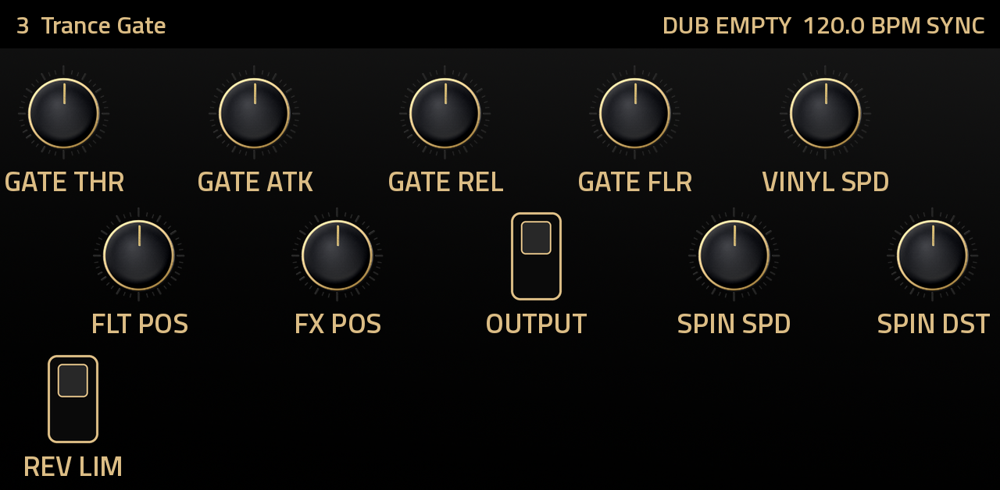
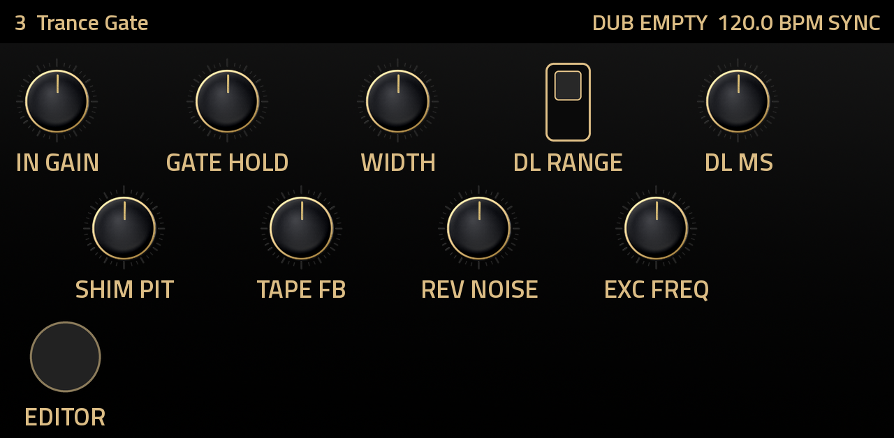
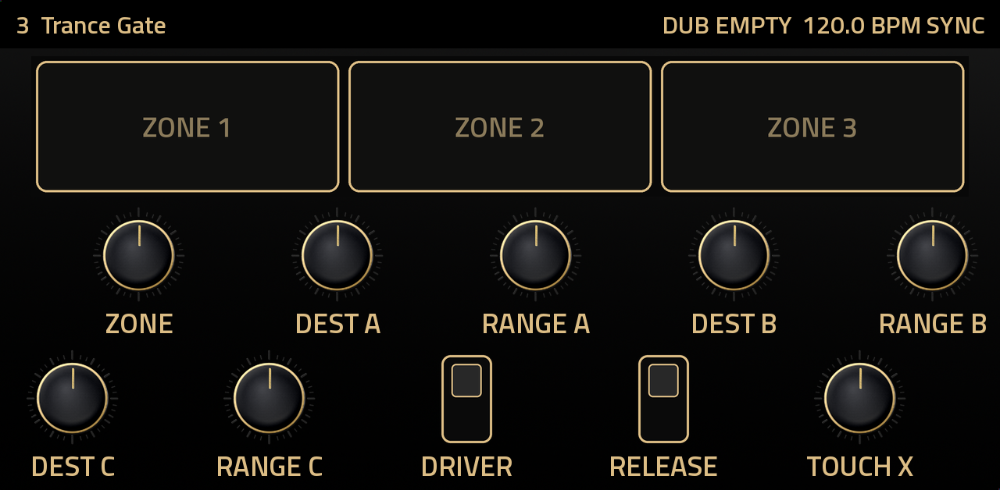
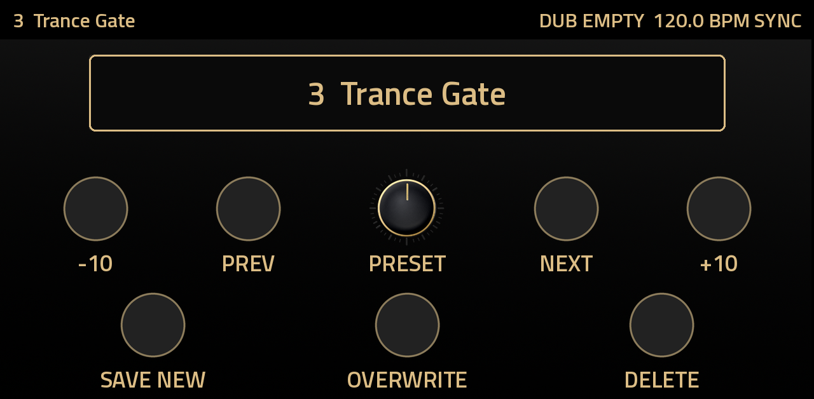

The new pages are shown as layout pictures made from the skin files, not photos of a Force.

## Install

Needs MPC OS 3.x on an armv7 Force/MPC. Download `MORI-<version>-mpc-armv7.zip` from the Releases page, unzip it, and follow `INSTALL.md` inside (or run `install.sh` on the device). MORI is an effect: put it on a track's insert or send.

## The browser editor

Connect the Force to your network, load MORI, press **EDITOR** on the SOUND page and type the address it shows (for example
`http://192.168.1.23:8765`) into a browser on a phone or computer on the same network. Details in the [user guide](docs/USER_GUIDE.md), section 13.
The editor has no password: anyone on the same network can open it while MORI is loaded.

## Documentation

* [User guide](docs/USER_GUIDE.md): how it works, every control, and how to use it musically.
* [Changelog](CHANGELOG.md)
* [Credits](CREDITS.md)

## Status

0.6.4 was tested on an Akai Force on 2026-11-14: the FILTER zone opens from left to right and the touch bar no longer stays on other screens or other plugins. The browser editor was confirmed working on the Force with 0.6.1. See [docs/UNVERIFIED.md](docs/UNVERIFIED.md) for the points not individually confirmed yet.

## License

PolyForm Noncommercial 1.0.0, see [LICENSE](LICENSE). The source is public and free to use, change and share for any noncommercial purpose; selling MORI or using it commercially is not permitted. The build framework is third-party code under its own licence.

## Support

Free plugin. Tips: ko-fi.com/lcronx
