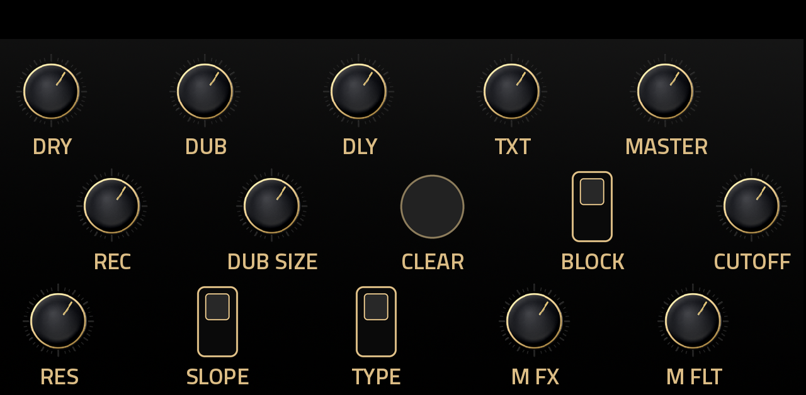
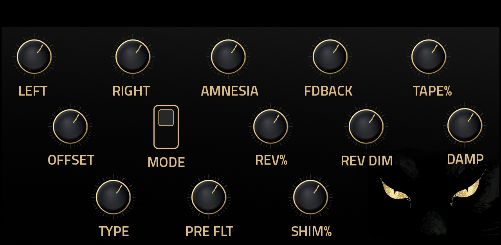
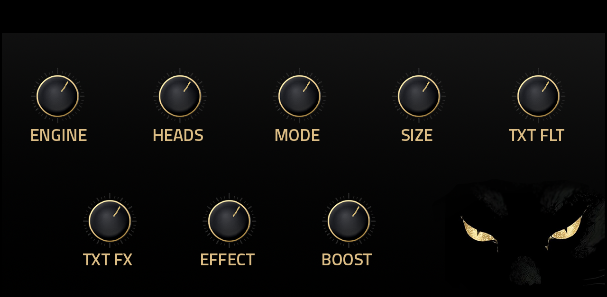
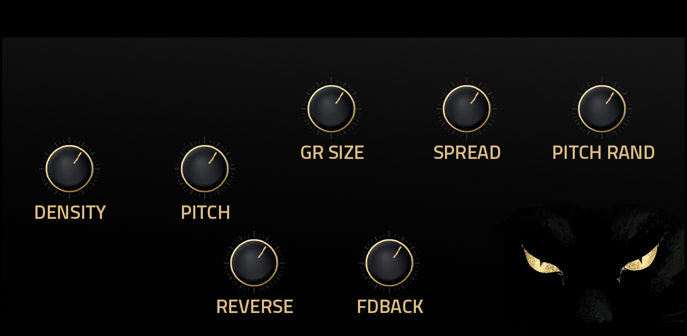
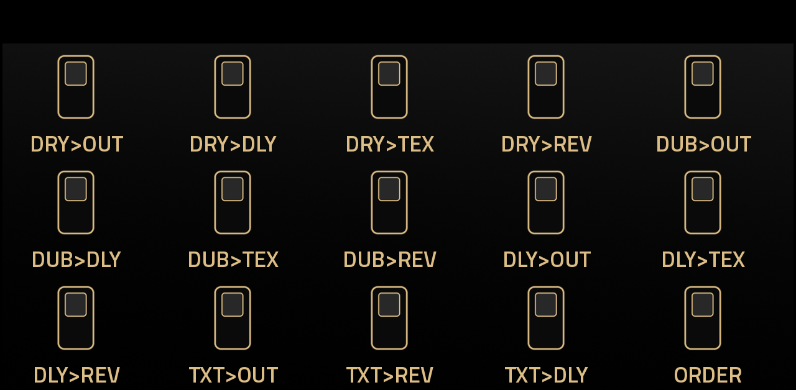

# MORI

**A love letter to [MEMENTO | Enjoy-Lab](https://www.enjoy-lab.com/memento).** MORI is my own circuitry, programmed by logic: not their code, not a clone, not a port. For the Akai Force and MPC OS (VST2, ARMv7). Vendor: L'Cronx. Current version: 0.3.1. Tested on Akai Force.

MORI is an effect for making sound drift, repeat and dissolve. Play anything through it, then record a loop of what you hear into the DUB layer,
send the result around a delay, a memory of moving heads or a cloud of grains, and let it all fall into a reverb. Five pages, big
knobs, nothing hidden.

## What it does

* **DUB** – a loop that follows the project tempo (1 to 16 beats). Record into it, add layers, replace it, or let it forget.
* **DELAY** – a stereo delay with a different note value on each side, tape-style or jumping time changes, and a filter inside the feedback.
* **TEXTURE** – a short memory of the last seconds of sound, played back by several heads at different speeds and directions, or cut into grains. Freeze it with BLOCK.
* **REVERB** – five characters, with a high-pass before the reverb and an octave-up shimmer.
* **FILTER** – one knob sweeps low-pass to the left and high-pass to the right.
* **MASTER FX** – exciter, tape saturation or tube warmth, then a soft limiter.
* **ROUTING** – 14 switches decide who feeds whom, plus one switch for the order of DELAY and TEXTURE.

## The panel

## Install

Needs MPC OS 3.x on an armv7 Force/MPC. Download `MORI-<version>-mpc-armv7.zip` from the Releases page, unzip it, and follow `INSTALL.md` inside (or run `install.sh` on the device). MORI is an effect: put it on a track's insert or send.

## Documentation

* [User guide](docs/USER_GUIDE.md): how it works, every control, and how to use it musically.
* [Changelog](CHANGELOG.md)
* [Credits](CREDITS.md)

## Status

Built, packaged, and passes the installer and catalog checks. See [docs/UNVERIFIED.md](docs/UNVERIFIED.md) for what still needs confirming on the Force.

## License

PolyForm Noncommercial 1.0.0, see [LICENSE](LICENSE). The source is public and free to use, change and share for any noncommercial purpose; selling MORI or using it commercially is not permitted. The build framework is third-party code under its own licence.

## Support

Free plugin. Tips: ko-fi.com/lcronx
